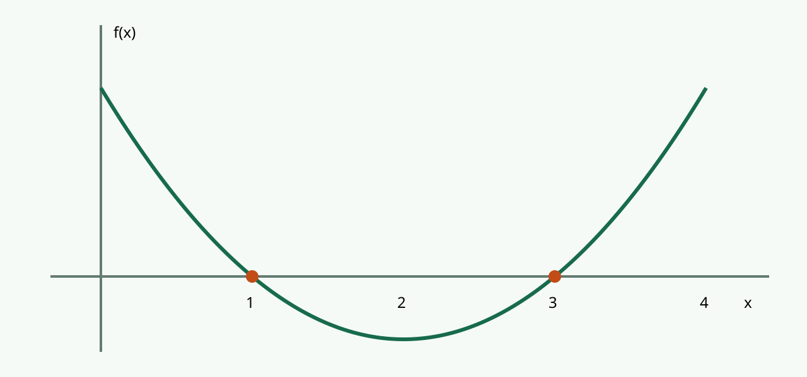

<!-- BEARBEITEN: Namen, Kurs, Fragestellung und Quellen durch eigene Angaben ersetzen.
Das Beispiel demonstriert Funktionen; es ist keine fertige wissenschaftliche Arbeit. -->

# Kurzfassung {.unnumbered}

Diese Vorlage verbindet die mathematische Untersuchung quadratischer Funktionen mit einer Unterrichtsplanung zu zweit. Sie zeigt Formeln, Definitionen, einen Beweis, Abbildungen, Tabellen, Querverweise, Fußnoten und Literaturangaben. In der HTML-Ausgabe ergänzen interaktive Übungen den Text.

# Einleitung und Fragestellung

**Leitfrage:** Wie lassen sich die Nullstellen quadratischer Funktionen rechnerisch und grafisch bestimmen?

Am Beispiel $f(x)=x^2-4x+3$ untersuchen wir Faktorisierung und Nullproduktregel. Anschließend planen wir eine Unterrichtsstunde, in der Lernende ihre Vermutungen an einem veränderbaren Graphen prüfen.

Eine ergänzende Erläuterung kann in einer normalen Fußnote stehen.^[Diese Fußnote ist eine Erläuterung und enthält keinen Quellenbeleg.]

# Mathematische Grundlagen

## Definition und nummerierte Gleichung

::: {#def-nullstelle}
## Nullstelle

Eine Zahl $x_0\in\mathbb{R}$ heißt **Nullstelle** einer Funktion $f$, wenn $f(x_0)=0$.
:::

Die allgemeine quadratische Funktion lautet

$$
f(x)=ax^2+bx+c,\qquad a\ne0.
$$ {#eq-quadratisch}

@eq-quadratisch beschreibt eine quadratische Funktion; @def-nullstelle erklärt den Begriff der Nullstelle. Ein allgemeiner Literaturhinweis zur Analysis steht hier als Quellenfußnote.^[@spivak2008]

## Satz und Beweis

::: {#thm-nullprodukt}
## Nullproduktregel

Für $u,v\in\mathbb{R}$ gilt: $uv=0$ genau dann, wenn $u=0$ oder $v=0$.
:::

::: {.proof}
Ist ein Faktor null, so ist das Produkt null. Umgekehrt gelte $uv=0$. Falls $u=0$, ist die Behauptung erfüllt. Falls $u\ne0$, liefert die Division durch $u$ die Gleichung $v=0$.
:::

Mit @thm-nullprodukt erhalten wir:

$$
\begin{aligned}
x^2-4x+3&=(x-1)(x-3),\\
f(x)=0&\iff x=1\ \text{oder}\ x=3.
\end{aligned}
$$ {#eq-loesung}

## Abbildung und Tabelle

{#fig-parabel width=85%}

@fig-parabel zeigt die beiden Nullstellen aus @eq-loesung. Die Probe steht in @tbl-probe.

| $x$ | Rechnung | $f(x)$ |
| --- | --- | --- |
| $1$ | $1-4+3$ | $0$ |
| $3$ | $9-12+3$ | $0$ |

: Rechnerische Überprüfung der Nullstellen. {#tbl-probe}

## Die Diskriminante

Für $D=b^2-4ac$ und $a\ne0$ gilt:

| Diskriminante | Reelle Nullstellen | Beispiel |
| --- | --- | --- |
| $D>0$ | zwei verschiedene | $x^2-4x+3$ |
| $D=0$ | eine doppelte | $x^2-4x+4$ |
| $D<0$ | keine | $x^2+1$ |

# Interaktiver Anhang im Browser {#sec-labor}

::: {.content-visible when-format="html"}

## Parameter am Graphen untersuchen

Verändere die Regler. Gleichung, Graph, Scheitel und Nullstellen aktualisieren sich gemeinsam. Der sichtbare Ausschnitt bleibt bei $x\in[-8,8]$ und $y\in[-7{,}5,7{,}5]$. Nullstellen außerhalb dieses Ausschnitts erscheinen weiterhin als Zahlen.



**Auftrag:** Vergleiche die drei Voreinstellungen und erkläre den Zusammenhang mit der Diskriminante. Setze anschließend $a=0$ und beschreibe den Sonderfall.

## Quiz mit Rückmeldung



## Eigene Lösungen eingeben



Die Reihenfolge der beiden Nullstellen ist egal. Dezimalkomma und Dezimalpunkt werden akzeptiert.

## Lösungen bei Bedarf aufklappen

<details class="demo-solution">
<summary>Hinweis anzeigen</summary>

Suche zwei Zahlen, deren Summe $5$ und deren Produkt $6$ ist.

</details>

<details class="demo-solution">
<summary>Vollständige Musterlösung anzeigen</summary>

$$g(x)=x^2-5x+6=(x-2)(x-3).$$

Aus der Nullproduktregel folgen $x_1=2$ und $x_2=3$. Die Probe liefert $g(2)=0$ und $g(3)=0$.

</details>

## Arbeitszeit steuern



Der Timer läuft nach dem Start auch beim Scrollen weiter. Vor einer Unterbrechung auf **Pause** klicken. Alle Eingaben bleiben lokal im geöffneten Browser; beim Neuladen werden sie zurückgesetzt.

:::

::: {.content-visible when-format="pdf"}

Die HTML-Version enthält einen veränderbaren Funktionsgraphen, ein Quiz, einen Lösungsprüfer, aufklappbare Lösungen und einen Timer. In einer PDF sind diese Interaktionen nicht verfügbar.

**Ersatzaufgabe auf Papier:** Untersuche $x^2-4x+3$, $x^2-4x+4$ und $x^2+1$ mithilfe der Diskriminante. Bestimme anschließend die Nullstellen von $g(x)=x^2-5x+6$.

**Musterlösung:** Die drei Diskriminanten sind $4$, $0$ und $-4$. Für $g$ gilt $g(x)=(x-2)(x-3)$ mit den Nullstellen $2$ und $3$.

:::

# Didaktische Planung der Unterrichtsstunde

| Zeit | Phase | Tätigkeit und Zuständigkeit |
| --- | --- | --- |
| 5 min | Einstieg | Person 1 aktiviert Vorwissen. |
| 10 min | Erarbeitung | Person 2 entwickelt die Faktorisierung an der Tafel. |
| 15 min | Partnerarbeit | Beide begleiten die Aufgaben aus @sec-labor. |
| 10 min | Sicherung | Person 1 rechnet; Person 2 moderiert den Vergleich. |
| 5 min | Lernzielkontrolle | Person 2 setzt das Quiz ein. |

## Zusammenarbeit zu zweit

Eine Person moderiert, während die andere Zeit und Rückfragen beobachtet. Beide prüfen Rechnung, Quellen und Lesbarkeit. Die Rollen A und B der Partneraufgabe beziehen sich auf die Lernenden.

> **Einsatz im Unterricht:** Lasst die Gruppe zuerst eine Vermutung formulieren und verändert danach den Graphen. Die Rückmeldung im Quiz unterstützt die Erklärung; sie ersetzt das gemeinsame Begründen nicht.

# Zitierwerkstatt: Fußnoten in Aktion

> **Layoutdemonstration:** Die folgenden Fundstellen sind ungeprüfte Beispiele. Der Satz in Anführungszeichen ist erfundener Demotext und kein Originalzitat. Vor Abgabe durch geprüfte Belege ersetzen.

## Einzelne Seiten und Seitenbereiche

Ein allgemeiner Buchverweis.^[@polya1945]

Eine konkrete Seite.^[@polya1945, S. 23]

Eine andere Stelle im selben Buch.^[@polya1945, S. 42]

Ein zusammenhängender Seitenbereich.^[@spivak2008, S. 10–12]

## Indirekte und direkte Zitate

Eine sinngemäße Beispielaussage mit Vorsatz.^[Vgl. @polya1945, S. 23–25.]

„Erfundener Demotext für die Darstellung eines direkten Zitats.“^[@polya1945, S. 23]

Eine Aussage mit zwei Quellen in einer Fußnote.^[@polya1945; @spivak2008]

Zwei unterschiedliche Fundstellen lassen sich ebenfalls gemeinsam nennen.^[@polya1945, S. 23; @spivak2008, S. 10–12]

## Syntax zum Nachbauen

```markdown
Aussage.^[@polya1945]
Aussage.^[@polya1945, S. 23]
Aussage.^[Vgl. @polya1945, S. 23–25.]
„Geprüfter Originalwortlaut“.^[@polya1945, S. 23]
Aussage.^[@polya1945; @spivak2008]
```

Die Buchdaten stehen in `literatur.bib`. Ein Eintrag allein erzeugt keinen Beleg; dafür muss der Schlüssel an der passenden Textstelle stehen. Der Zitierstil dieser Vorlage verwendet Autor-Jahr-Belege in expliziten Fußnoten. Einen vorgeschriebenen Hochschulstil können wir später über eine CSL-Datei einstellen.

# Quarto-Werkstatt: häufige Bausteine

## Text, Listen und Mathematik

```markdown
**fett**, *kursiv*, [Link](https://quarto.org)

- Erster Punkt
- Zweiter Punkt

Mathematik im Text: $x^2 + 1$.

$$
f(x)=ax^2+bx+c
$$ {#eq-meine-formel}

Verweis: @eq-meine-formel
```

## Bild mit Beschriftung und Querverweis

```markdown
{#fig-mein-bild}

Siehe @fig-mein-bild.
```

Eigene Bilder im Ordner `assets` ablegen; direkt am Bild Urheber, Quelle und gegebenenfalls Lizenz ergänzen.

## Browser und PDF erzeugen

```sh
quarto preview main.qmd
quarto render main.qmd --to html
quarto render main.qmd --to pdf
```

Für die HTML-Ausgabe genügt Quarto. Die PDF-Ausgabe braucht zusätzlich eine LaTeX-Installation und nutzt das Standardlayout dieser Vorlage. Interaktive Elemente stehen in der HTML-Version zur Verfügung; die PDF enthält stattdessen eine Papieraufgabe mit Musterlösung.

# Fazit und Reflexion

Faktorisierung, Nullproduktregel und graphische Kontrolle ergänzen sich. Der veränderbare Graph macht den Übergang zwischen zwei, einer und keiner reellen Nullstelle sichtbar. Die wissenschaftlichen Bausteine dieser Vorlage lassen sich auf ein anderes Thema übertragen.

# Literaturverzeichnis {.unnumbered}

::: {#refs}
:::
