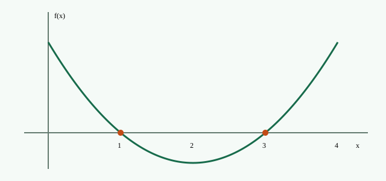

<!-- BEARBEITEN: Titel, Namen und Inhalt ersetzen. ## beginnt eine neue Folie.
Die HTML-Bausteine liegen im Ordner assets. Keine zusätzlichen Pakete nötig. -->

## Heute ausprobieren

1. **Mathematik darstellen:** Formeln, Definition, Beweis und Graph.
2. **Gemeinsam entdecken:** Parameter ändern und Vermutungen prüfen.
3. **Selbst aktiv werden:** Quiz, Eingabefelder und Musterlösung.
4. **Wissenschaftlich arbeiten:** Quellenfußnoten und Literaturverzeichnis.

::: notes
Person 1 begrüßt. Person 2 öffnet später das Parabel-Labor. Die andere Person beobachtet Zeit und Fragen.
:::

## Leitfrage und Lernziele

::: {.callout-tip}
## Wie finden wir die Nullstellen einer quadratischen Funktion?

Am Ende könnt ihr Gleichung und Graph verbinden, Nullstellen durch Faktorisieren bestimmen und eure Lösung überprüfen.
:::

**Einstieg:** Was bedeutet eine Nullstelle im Graphen?

## Stundenplan zu zweit

| Zeit | Phase | Zuständigkeit / Medium |
| --- | --- | --- |
| 5 min | Einstieg und Vorwissen | Person 1 · Gespräch |
| 10 min | Gemeinsam herleiten | Person 2 · Tafel |
| 15 min | Erkunden und üben | beide · Browser / Partnerarbeit |
| 10 min | Ergebnisse sichern | Person 1 rechnet, Person 2 moderiert |
| 5 min | Lernzielkontrolle | Person 2 · Quiz |

## Definition und Formel

Eine quadratische Funktion hat die Form

$$
f(x)=ax^2+bx+c,\qquad a,b,c\in\mathbb{R},\quad a\ne0.
$$ {#eq-allgemein}

**Definition:** $x_0$ heißt Nullstelle, wenn $f(x_0)=0$.

Hintergrund zur Analysis.^[Beispiel für eine Quellenfußnote: @spivak2008. Die konkret verwendete Stelle vor Abgabe prüfen.]

## Tafelauftrag

Bestimmt die Nullstellen von $f(x)=x^2-4x+3$.

::: {.incremental}
- Was bedeutet $f(x)=0$ für den Graphen?
- Welche zwei Zahlen haben Summe $4$ und Produkt $3$?
- Nutzt die Nullproduktregel.
:::

::: notes
Zunächst an der echten Tafel rechnen. Die folgende Folie erst zur Ergebnissicherung öffnen.
:::

## Ergebnissicherung in Schritten

::: {.columns}
::: {.column width="48%"}
$$
\begin{aligned}
0&=x^2-4x+3\\
 &=(x-1)(x-3)
\end{aligned}
$$

. . .

Also $x_1=1$ oder $x_2=3$.

. . .

**Probe:** $f(1)=0$ und $f(3)=0$.
:::
::: {.column width="52%"}
{width=95%}
:::
:::

## Parabel-Labor: selbst verändern



::: notes
Erst c verändern: Wann berührt die Parabel die x-Achse? Dann a negativ setzen. Bei a=0 wird die Funktion linear; das Labor zeigt diesen Sonderfall ausdrücklich an. Die Achsengrenzen bleiben fest, damit Änderungen vergleichbar bleiben.
:::

## Forscheraufträge

::: {.incremental}
1. Lade **Zwei Nullstellen**. Erhöhe $c$ von $3$ auf $4$ und dann auf $5$.
2. Beschreibe, was mit den Schnittpunkten passiert.
3. Lade **Keine Nullstelle**. Setze $a=-1$: Was ändert sich?
4. Setze $a=0$: Warum ist die Funktion jetzt nicht mehr quadratisch?
:::

Geht dafür mit der linken Pfeiltaste zurück zum Labor.

## Satz und kurze Begründung

**Nullproduktregel:** Für $u,v\in\mathbb{R}$ gilt

$$uv=0\iff u=0\ \text{oder}\ v=0.$$

. . .

**Beweisidee:** Ist $u\ne0$, dürfen wir durch $u$ teilen und erhalten $v=0$. Ist ein Faktor null, ist das Produkt null. $\square$

## Quiz mit direkter Rückmeldung



::: notes
Erst im Raum abstimmen lassen, dann eine Antwort anklicken. Die Rückmeldung bleibt auf diesem Gerät; es gibt keine gemeinsame Online-Abstimmung.
:::

## Partnerarbeit

Bestimmt die Nullstellen von $g(x)=x^2-5x+6$ und prüft sie.

Person A rechnet, Person B erklärt und kontrolliert. Tauscht anschließend die Rollen.



::: notes
Der Timer startet erst nach einem Klick. Beim Folienwechsel läuft er weiter; vor einer Unterbrechung Pause wählen.
:::

## Lösung selbst prüfen



<details class="demo-solution">
<summary>Musterlösung öffnen</summary>

$$g(x)=x^2-5x+6=(x-2)(x-3).$$

Also $x=2$ oder $x=3$. Probe: $g(2)=4-10+6=0$ und $g(3)=9-15+6=0$.

</details>

## Drei Fälle vergleichen

::: {.columns}
::: {.column width="50%"}
$$D=b^2-4ac$$

- $D>0$: zwei reelle Nullstellen
- $D=0$: eine doppelte Nullstelle
- $D<0$: keine reelle Nullstelle
:::
::: {.column width="50%"}
::: {.callout-note}
## Voraussetzung

Die Fallunterscheidung gilt für $a\ne0$.

Beispiele im Labor: $x^2-4x+3$, $x^2-4x+4$ und $x^2+1$.
:::
:::
:::

## Quellenfußnoten: einzelne Fundstellen {.smaller}

**Layoutdemo:** Alle folgenden Seitenzahlen sind ungeprüft.

- Allgemeiner Buchverweis.^[@polya1945]
- Eine konkrete Seite.^[@polya1945, S. 23]
- Andere Stelle desselben Buchs.^[@polya1945, S. 42]
- Ein Seitenbereich.^[@spivak2008, S. 10–12]

Die vollständigen Angaben entstehen automatisch aus `literatur.bib`.

## Indirekt, direkt und mehrere Quellen {.smaller}

**Layoutdemo:** Seiten ungeprüft; der zitierte Satz ist erfundener Demotext.

- Sinngemäße Beispielaussage.^[Vgl. @polya1945, S. 23–25.]
- „Erfundener Demotext für die Darstellung eines direkten Zitats.“^[@polya1945, S. 23]
- Zwei Bücher in einer Fußnote.^[@polya1945; @spivak2008]

Echte Zitate benötigen geprüften Wortlaut und tatsächliche Fundstelle.

## Zitate selbst schreiben {.smaller}

```markdown
Aussage.^[@polya1945]
Aussage.^[@polya1945, S. 23]
Aussage.^[Vgl. @polya1945, S. 23–25.]
Aussage.^[@polya1945; @spivak2008]
```

Einträge mit passenden Schlüsseln in `literatur.bib` ergänzen. Die Seitenzahl steht direkt im Text beim Beleg.

## Folien selbst erweitern {.smaller}

````markdown
## Meine neue Folie

Text mit **Hervorhebung** und $x^2$.

. . .

Dieser Absatz erscheint beim nächsten Schritt.

::: notes
Nur in der Sprecheransicht sichtbar.
:::
````

## Bedienung und Einsatz

- **← / →:** Folien; **Esc:** Übersicht; **F:** Vollbild; **S:** Sprecheransicht.
- Im Regler steuern die Pfeiltasten den Parameter.
- Quiz, Timer und Eingaben laufen lokal auf dem jeweiligen Gerät.
- Antworten werden nicht gesammelt oder dauerhaft gespeichert.
- Ein PDF zeigt feste Inhalte; Regler, Quiz und Timer brauchen die HTML-Version.

::: notes
Für die Sprecheransicht gegebenenfalls Pop-ups erlauben. Vor dem Vortrag einmal alle Interaktionen auf dem tatsächlichen Präsentationslaptop öffnen.
:::

## Literaturverzeichnis {.smaller}

::: {#refs}
:::
